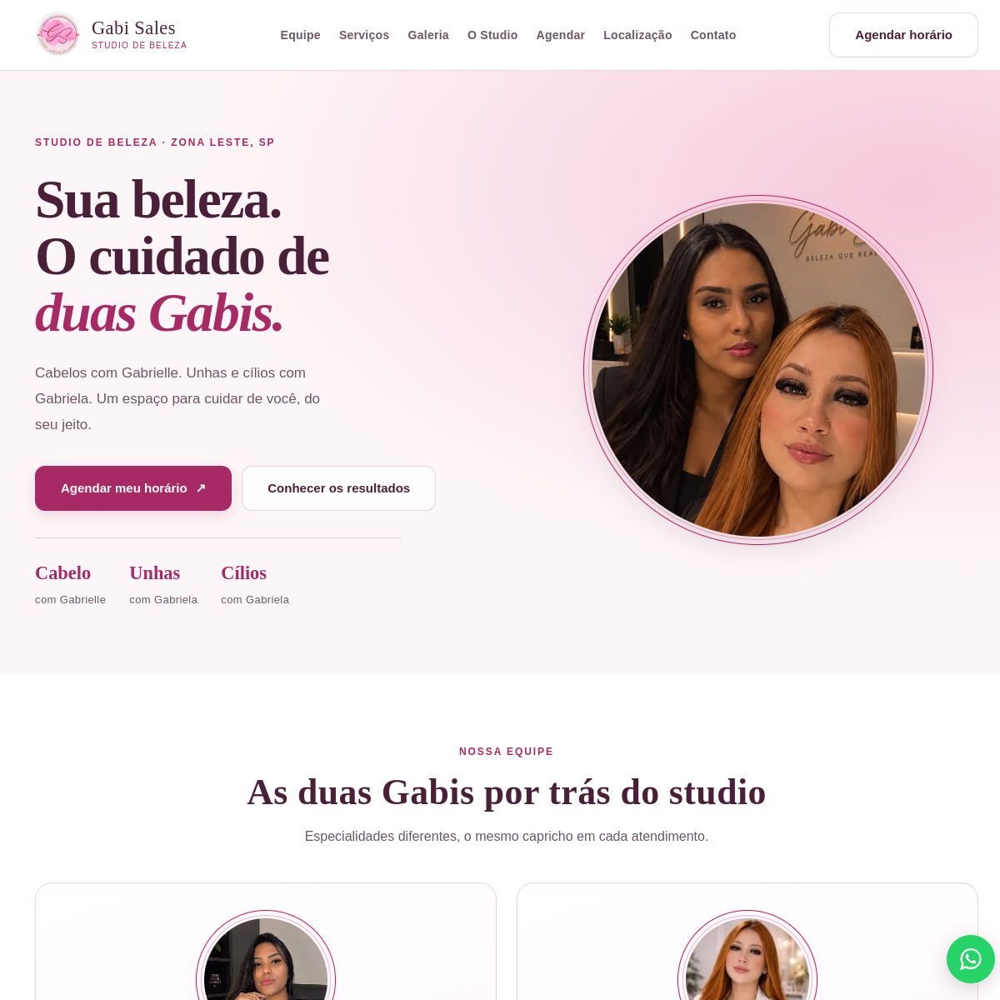

# Studio Gabi Sales — site institucional

Site institucional desenvolvido como projeto freelancer para o Studio Gabi Sales, estúdio de beleza na Zona Leste de São Paulo.

🔗 **Site publicado:** [studiogabisales.com](https://studiogabisales.com/)

## Sobre o projeto

O site apresenta o estúdio, seus serviços e a equipe, com galerias de trabalhos e caminhos de contato e agendamento. O desenvolvimento incluiu a organização do conteúdo, implementação da interface, testes e publicação.

## Tecnologias

- HTML5
- CSS3
- JavaScript

## Recursos

- Layout responsivo
- Apresentação de serviços, equipe e trabalhos
- Links para contato e agendamento pelo WhatsApp
- Integração com Instagram e Google Maps
- SEO básico, sitemap e configuração de rastreamento
- Carregamento otimizado de imagens e vídeos

## Executar localmente

Abra `index.html` em um navegador. O projeto é estático e não requer etapa de build.

## Autoria e materiais

Implementação e publicação: Gustavo Sales. A marca, as fotografias e os vídeos pertencem ao Studio Gabi Sales e às pessoas retratadas; os materiais são mantidos aqui para demonstrar o projeto publicado. Todos os direitos sobre esses materiais permanecem com seus respectivos titulares.
